<h1><code>krish@github:~$ whoami</code></h1>

**Krish Gupta** · AI/ML Engineer · GenAI Developer

Building practical AI systems, agentic workflows, and reliable data products.

<a href="https://www.linkedin.com/in/krish-gupta-exe/">LinkedIn</a> · <a href="https://github.com/Krish-labs">GitHub</a>

---

<h3><code>krish@github:~$ ./contributions.sh</code></h3>

<h3><code>krish@github:~$ whoami --details</code></h3>

<table>
  <tr>
    <td valign="top" align="center"></td>
    <td valign="top"></td>
  </tr>
</table>

## <code>krish@github:~$ cat currently_building.txt</code>

- **Agentic AI & DataOps:** workflow orchestration, incident analysis, RAG, tool calling, and human-in-the-loop approvals.
- **Retrieval systems:** embeddings, hybrid search, metadata-aware filtering, semantic reranking, and source citations.
- **ML engineering:** model development, evaluation, APIs, and deployment.

## <code>krish@github:~$ tech --stack</code>

<code>Python</code> <code>SQL</code> <code>PySpark</code> <code>scikit-learn</code> <code>XGBoost</code> <code>TensorFlow</code> <code>LangGraph</code> <code>LangChain</code> <code>RAG</code> <code>Vector Databases</code> <code>FastAPI</code> <code>Streamlit</code> <code>Databricks</code> <code>GitHub Actions</code>

## <code>krish@github:~$ contact</code>

- LinkedIn: [krish-gupta-exe](https://www.linkedin.com/in/krish-gupta-exe/)
- Email: [krishgupta.exe@gmail.com](mailto:krishgupta.exe@gmail.com)

---

Repository-owned SVGs · Python-generated contribution calendar · Refreshed daily with GitHub Actions

